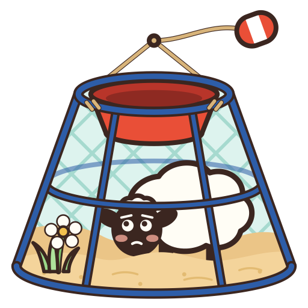

<p align="center">
  
</p>

# shep-sandbox

[](https://crates.io/crates/shep-sandbox)
[](https://github.com/shep-pm/shep-sandbox#license)

Run a [shep](https://github.com/shep-pm/shep) sheep inside a [crabpot](https://github.com/shep-pm/crabpot) sandbox. Linux and macOS.

## Adopt it

```sh
cargo install shep-sandbox --locked
shep adopt shep-sandbox --yes
```

shep names the dog `sandbox`. It needs shep 0.22 or newer, the first that spawns a sheep through it. From 0.23 the old `sandbox` key is refused, and this dog replaces it.

## Sandbox a sheep

Give the sheep an `[app.dogs.sandbox]` table. The shepherd then spawns it as `shep-sandbox launch <sheep> -- <command>`, and the dog runs the command under crabpot with that table.

```toml
[[app]]
name = "reactmap"
script = "node"
args = ["."]
cwd = "~/ReactMap"
env = { NODE_USE_ENV_PROXY = "1" }

[app.dogs.sandbox.network]
allowedDomains = ["raw.githubusercontent.com", "github.com"]
# Linux. On macOS, use allowLocalBinding = true instead (see below).
publish = ["127.0.0.1:8080"]
allowTcp = ["db.example.com:3306"]

[app.dogs.sandbox.filesystem]
denyRead = ["~/.ssh", "~/.shep"]
```

The table takes crabpot's settings keys, spelled as crabpot spells them. `shep-sandbox --schema` serves crabpot's JSON Schema for them as `x-shep-sheep`, and `shep` checks a table against it before writing it.

- The sheep's cwd is added to `filesystem.allowWrite`. Writes go only there, to the rest of `allowWrite` and to a temp folder.
- Reads are open except for `denyRead`, so deny what the sheep has no business reading, such as other services' configs.
- The five lists crabpot requires may be left out. The dog fills each with an empty list.
- A key crabpot does not know is dropped, as crabpot drops it.

## Editing a running sheep

The dog follows the sheep's table while it runs.

```sh
shep set reactmap.dogs.sandbox.network.allowedDomains '["raw.githubusercontent.com", "cdn.jsdelivr.net"]'
```

- `network.allowedDomains`, `network.deniedDomains` and `network.deniedResolvedAddresses` apply at once, with no restart.
- Any other key needs a restart. The sheep's err log says so, naming the key: `shep-sandbox: reactmap: filesystem.denyRead changed, restart the sheep to apply it`.
- A table crabpot refuses is logged the same way, and the settings in force stay.
- If the shepherd connection drops, the sandbox keeps its last lists while the dog reconnects.

## Platform notes

- Node ignores proxy variables by default, so its outbound requests fail with `ENOTFOUND`. Set `NODE_USE_ENV_PROXY = "1"` in the sheep's `env` (Node 22.21 or 24.5 and newer).
- macOS: a sheep that watches files (chokidar, nodemon, a config reloader) needs `allowMachLookup = ["com.apple.FSEvents"]` under `network`. Without it the watcher fails silently.
- macOS: `allowTcp` is refused, since Seatbelt cannot limit it to one host. `allowLocalBinding = true` lets the sheep listen and also dial any port on localhost, such as a local database.
- Linux: a sheep that listens needs its address in `network.publish`, and a sheep that dials a host directly, such as a database, needs it in `network.allowTcp`.
- Windows is not supported. `launch` exits 125 there.

## Refusals

Every refusal exits 125 with one line on stderr naming the cause, and shep marks the sheep errored without restarting it. A command crabpot never reached never runs: there is no fallback outside the sandbox.

Do not let a sheep reach the shepherd's control socket. That socket trusts any process of the same user, so a sheep that connects to it holds the operator's authority over the whole flock. `network.allowAllUnixSockets`, or a `network.allowUnixSockets` entry that reaches `$SHEP_HOME/run/shep.sock`, grants exactly that.

## License

MIT OR Apache-2.0, at your option. The logo is crabpot's, with shep's sheep in place of Ferris.
